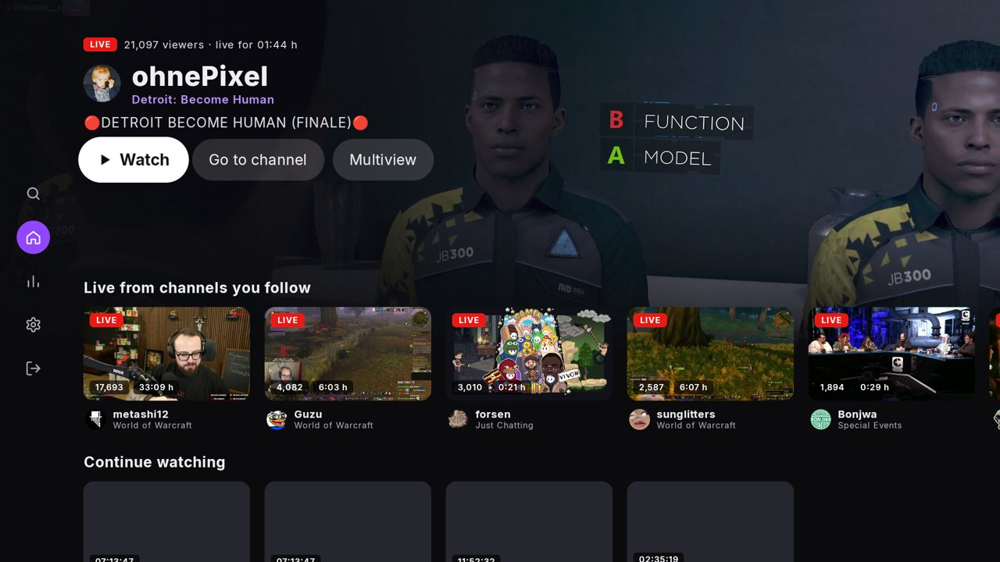
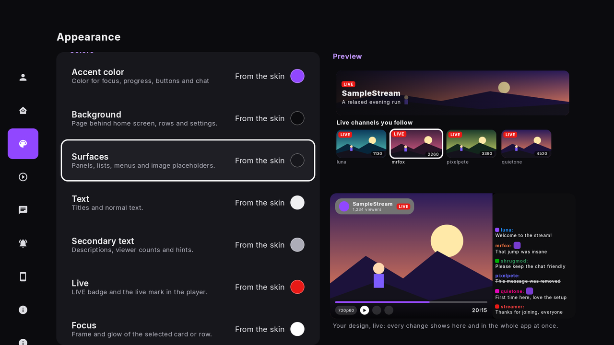
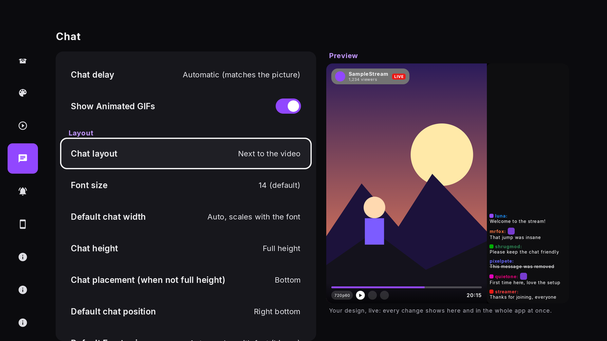
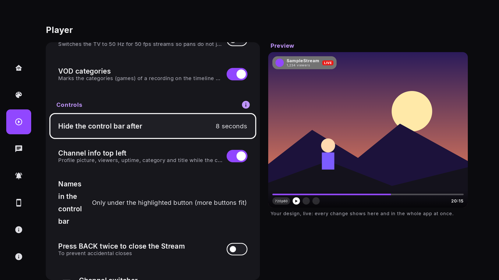
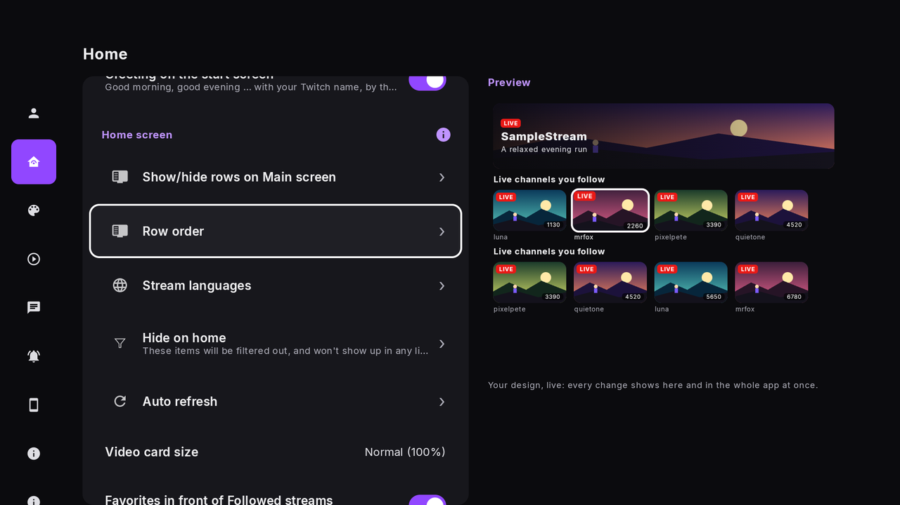
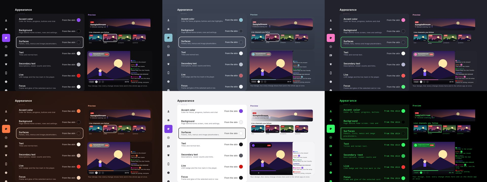
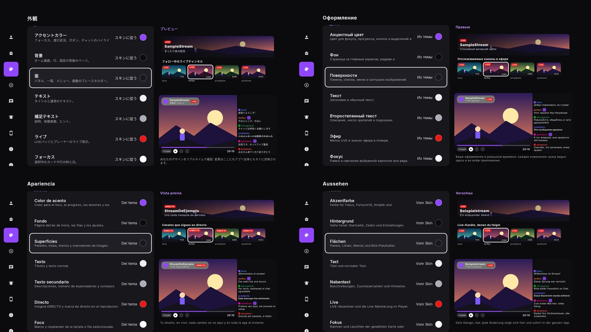

<p align="center"></p>

<p align="center">
  <b>Twitch on your TV, made for the remote.</b><br>
  Live streams, VODs, chat and your followed channels, with settings you can see changing while you tune them.
</p>

<p align="center">
  
  
  
  
</p>

<p align="center"></p>

> ShrugTV is an unofficial client. It is not affiliated with, endorsed by or sponsored by Twitch. Twitch is a trademark of its owner.

> **Made with AI.** A large part of ShrugTV was developed with the help of AI coding assistants: much of the code, the tests,
> the documentation and the translations. The author directs the work, tests the app on real TVs and reviews the results, but
> AI-written code can contain mistakes. Please report anything that looks wrong.

**Contents:** [Why ShrugTV](#why-shrugtv) · [Features](#features) · [Remote control](#remote-control) · [Install](#install) · [Settings](#settings-with-a-live-preview) · [Languages](#languages) · [Phone companion](#phone-companion) · [Build](#build) · [FAQ](#faq) · [Privacy](#privacy) · [Contributing](#contributing) · [Licence](#licence)

---

## Why ShrugTV

- **Built for the couch.** Every screen is reachable with arrows, OK and Back. No pointer, no keyboard needed.
- **Fast to switch.** Up/Down in the player step through your followed channels, the same category, recent and top streams without going back to a list.
- **Yours to style.** Ten skins, and every colour, corner, font and animation can be changed on its own, with a live preview next to the list.
- **Private by default.** No telemetry, no analytics, no crash reporter, no third-party servers. The TV talks to Twitch directly.
- **Open.** Apache-2.0, readable code, unit tests, and a build you can reproduce with your own Twitch application.

## Features

| | |
|---|---|
| **Live, VOD, chat** | Followed channels, categories, search, channel pages, highlights, uploads and chapters. |
| **Hero home screen** | A muted live preview of the selected stream; rows can be shown, hidden and reordered. Multiview shows two streams side by side. |
| **Channel switcher** | Up in the player opens a list of followed, same category, recent and top streams; Up/Down again cycles the list. |
| **Replay and live rewind** | Jump back in a live stream and return to live with one key. |
| **Chat** | Animated new messages, merged spam, 7TV, BTTV and FFZ emotes, highlights, filters, layout next to or over the video, adjustable width, height, font and position. |
| **Audio only** | Listen without the picture; burn-in protection keeps OLED TVs safe. |
| **Quiet hours** | Silences "is live" notices at night. |
| **Viewing statistics** | What you watch, kept on the device only. |
| **Home Assistant** | Publishes what is playing over MQTT. |
| **12 languages** | Chosen in the app, independent of the system language. |

## Remote control

| Key | Does |
|---|---|
| **OK** | Opens the control bar |
| **Menu (≡)** | Opens "More" |
| **◀ ▶** | Live: previous/next channel. VOD: jump 10 s |
| **▲** | Channel switcher; ▲ ▼ again switch the list |
| **Channel ± / ⏮ ⏭** | Switch channel as well |
| **Info** | Shows the stream statistics |
| **Captions** | Toggles the chat |
| **⏩** | Jumps back to live |
| **Yellow** | Audio only |

Keys can differ slightly between remotes; every setting page has a short guide with the keys that matter there.

## Install

1. **With adb.** Download `shrugtv-<version>.apk` from the [latest release](https://github.com/ShrugTV/shrugtv/releases/latest),
   enable developer options and network debugging on the TV, then:
   ```bash
   adb connect <tv-ip>:5555
   adb install -r shrugtv-<version>.apk
   ```
2. **With the Downloader app (planned).** A short code will be published with the first release, so no PC is needed.
3. **Build it yourself.** See [Build](#build).

**Sign in** with *Login (Code)*: the TV shows a code and a QR code, you approve on your phone at `twitch.tv/activate`.
Your password is never typed on the TV.

## Settings with a live preview

Eight groups, a dot on every page that differs from the defaults, and *Reset this page*. The preview beside the list shows the home screen and the player with sample content, so a change is visible the moment you make it.

<p align="center">
  
  
</p>
<p align="center">
  
  
</p>

An *Advanced* level hides the rarely needed options until you ask for them.

### Skins

Ten skins ship with the app; pick one and adjust any single value on top. Own skins can be sent from the phone browser.

<p align="center"></p>

## Languages

English, German, Spanish, French, Portuguese, Italian, Polish, Turkish, Russian, Japanese, Korean and Chinese,
under *Settings → Appearance → App language*. The translations for the last ten were produced with tooling and still
want a native speaker's eye: corrections are very welcome.

<p align="center"></p>

## Phone companion

Open `http://<tv-ip>:8765` on a phone or PC in the same network to edit settings with a keyboard, send skins and read the changelog. It is only reachable inside your home network.

## Build

Requirements: JDK 17 and the Android SDK (platform 36).

```bash
./gradlew :app:testDebugUnitTest      # unit tests
./gradlew :app:assembleDebug          # debug APK in app/build/outputs/apk/debug/
```

Signing in needs **your own Twitch application**: register one at [dev.twitch.tv](https://dev.twitch.tv/console)
(type "Public", OAuth redirect URL `http://localhost`) and give the client ID to the build, either as the
environment variable `TWITCH_CLIENT_ID` or in `local.properties`:

```properties
twitch.clientId=your_client_id
```

Without it the app builds but sign-in and the Twitch API do not work. A release build needs the client ID
and, to be signed, `keystore.file` and `keystore.password` (or `SHRUGTV_KEYSTORE`, `SHRUGTV_KEYSTORE_PW`) in
`local.properties` or the environment; without a keystore the release APK stays unsigned.

## FAQ

**Does it block ads?** No. This edition plays what Twitch delivers; there is no ad blocker and no proxy.

**Does it need a Twitch account?** To follow channels and chat, yes. Sign-in uses Twitch's device-code flow.

**Which devices work?** Android TV, Google TV and Fire TV with Android 8 or newer, controlled with a normal remote.

**Is my data sent anywhere?** Only to Twitch, the optional update check (GitHub, off by default) and, for emotes, to the emote services you see in chat (7TV, BTTV, FFZ). Statistics never leave the TV.

**Why does sign-in fail in my own build?** The build has no Twitch client ID; see [Build](#build).

**Is this code written by AI?** To a large part, yes, see the note at the top. The result is covered by unit tests and used daily on a Fire TV; bugs are still possible, issues and pull requests are welcome.

**The text in my language looks off.** Please open an issue or a pull request; see [Languages](#languages).

## Privacy

No telemetry, no analytics, no crash reporter. Viewing statistics stay in a local database and are not part of
backups. The optional update check (off by default, Settings → App) asks `api.github.com` for the newest release once a day;
GitHub sees your IP address, nothing is downloaded or installed. The phone companion is only reachable inside your home network. Details: [PRIVACY.md](PRIVACY.md), also in the
app under Settings → About ShrugTV.

## Changes

See [CHANGELOG.md](CHANGELOG.md); the same text is the "Changes" page in the app.

## Contributing

Issues and pull requests are welcome, see [CONTRIBUTING.md](CONTRIBUTING.md). Code, comments and documentation are in English.

## Licence

[Apache License 2.0](LICENSE). Third-party components and their licences: [NOTICE](NOTICE), `docs/lizenzen/` and the app
(Settings → About ShrugTV → Licences).
